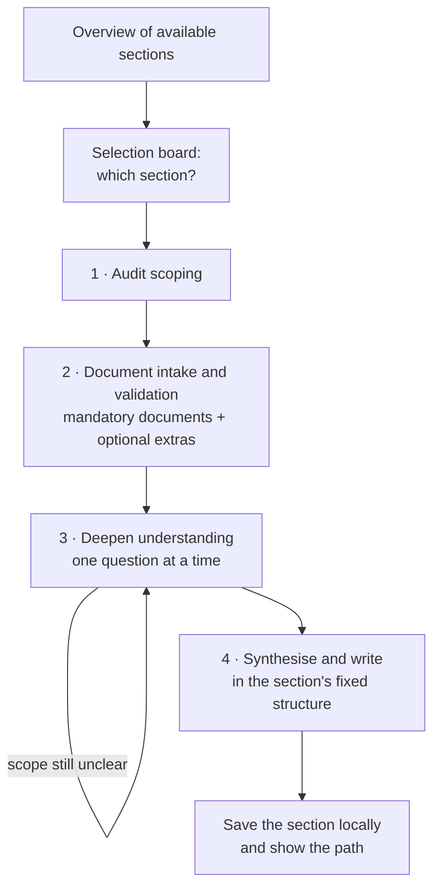

# APM-Writer

A conversational agent that helps an auditor draft sections of the Audit Planning Memorandum (APM) for an audit-with-opinion engagement. The auditor picks a section, the agent runs a structured, step-by-step intake (scope, documents, clarifying questions), and then writes the section in a fixed structure and saves it locally.

The agent is a **writing assistant, not a decision-maker**. It structures and formalises the auditor's own scoping and synthesis into APM language. It does not assess risk on its own and it does not write anything the provided evidence does not support.

## What the agent can write

An APM usually follows a fixed outline, so a section number always covers the same topic. When a session starts, the agent first gives an overview of the sections it can write. For example, they could be:

- 2.6.1: [section topic]
- 2.6.2: [section topic]
- 2.6.3: [section topic]

For each available section the overview says what the agent expects from you (the scope details and the documents it needs) and what you can expect back.

The available sections are set by the global variable `available_sections` at the top of `scripts/run.py`:

```python
available_sections = ['2.6.1', '2.6.2', '2.6.3']
```

Update that list to add or remove sections.

After the overview, the agent shows a selection board and asks which section you want:

```
Which APM section do you want to write?

  [ ] 2.6.1
  [ ] 2.6.2
  [ ] 2.6.3
```

One section is written per session. The workflow for the selected section then starts.

## How a session runs

Every section uses the same intake process. Only the mandatory documents and the structure of the final text differ per section.



### 1. Audit scoping

The agent opens with "What is your audit about?" and then builds the scope with you, one question at a time:

- audit objective
- what is in scope and what is explicitly out of scope
- audit period
- business lines, entities and, where relevant, product groups

It closes the step with a short summary (objective, scope, out of scope, timeline, organisational coverage) and asks you to confirm or correct it before it asks for documents.

### 2. Document intake and validation

Each section has its own **mandatory documents**. The agent asks for those first and leaves room for any **extra documents** you want it to use.

After the upload, the agent does not start writing. It lists every document it received and, for each one, states:

- what type of document it appears to be
- a short summary of what it contains
- why it is relevant for this specific audit

You confirm that the documents were understood correctly and are the right ones. If a mandatory document is missing, the agent asks for it, one item at a time.

### 3. Deepening understanding

The agent refines the scope with targeted questions that come from the documents themselves, for example which period a dataset relates to, which business unit it applies to, or whether it covers the full scope or a subset. After each refinement it gives a short scope update that separates:

- ✅ in scope
- ❌ out of scope
- ⚠️ unclear, to be confirmed

This step repeats until the scope and the inputs are clear and confirmed.

### 4. Synthesis and writing

Only then does the agent analyse across all documents (consistency and contradictions, signals of elevated risk or control weakness, trends, completeness) and write the section in the structure defined for it. It interprets and assesses; it does not copy text from the inputs.

### Saving the result

When the section is finished, the agent saves it as a file on your machine and tells you where, for example:

```
Section 2.6.1 saved to: ./output/apm-2.6.1_20260703_141500.md
```

Only the section that was written is saved. The conversation and the uploaded documents are not.

## How the agent talks to you

These rules apply in every step:

- **One question at a time.** The agent waits for your answer before it continues and never asks for everything at once.
- **Options instead of open questions.** If an answer is vague or incomplete, the agent proposes two or three structured options based on typical audit situations and asks you to confirm or adjust one.
- **A recap after each phase.** You see what the agent has understood and confirm it before the next phase starts.
- **Always steering towards scope.** Each recap states what is in scope, what is out of scope, and what still depends on further evidence.
- **No draft during the intake.** The section is written only after scope and documents are confirmed.

## Writing rules

All sections follow the same style:

- At most 8 paragraphs, preferably one per part of the section's structure, each 4 to 6 lines.
- About 70% conclusions and 30% supporting evidence.
- Plain, natural audit language; no bullet-heavy text, no repetition, no long descriptions of the inputs.
- Every part ends with a conclusion on **what should be included in the audit scope and why**.
- Only the final section text is returned: no introduction, no explanation of how the agent worked.

Rules that protect the content:

- **Source restriction.** Only the uploaded documents and your explicit input are used. Anything unsupported is left out, and missing information is stated as missing.
- **Traceability.** Key statements refer to the document and period they come from.
- **Explicit classification.** Matters of different kinds, such as a control issue, a reported incident and an unclassified event, are named as what they are and never merged. If a source does not make the classification clear, the text says so.
- **No harmonising.** The terminology of the sources is used as it is. If sources differ, the text notes the difference.
- **Scope discipline.** Material outside the confirmed scope is not used, not even for trend analysis.

## What the agent will not do

- Create content without input evidence.
- Replace the auditor's judgement or risk assessment.
- Infer root causes or severity that the inputs do not support.

The quality of the output depends directly on the quality of the input. The agent works best when you provide your own synthesis next to the raw documents: bullet-point summaries, the key risks and themes you see, and your first observations or concerns.

## Recommended way of working

1. Define the scope clearly.
2. Provide the documents together with your own synthesis.
3. Let the agent draft.
4. Review and refine the draft using your own judgement.

The goal is a co-produced APM section: driven by the auditor, structured by the agent.

## Data handling

The inputs for an APM are confidential and can contain personal data. Use the agent only in an environment that is approved for that material. Do not commit real audit evidence, personal data, generated sections or credentials to this repository; use synthetic or anonymised data for examples and tests.

## Status

`scripts/run.py` is a skeleton: it holds the `available_sections` list and a `main()` in which the workflow above is laid out as comments and placeholders. The steps are not implemented yet.

The plan for this agent is `plans/hackathon-2/junhan-wen-apm-assistant-agent.md`, submitted in [SAAF-Project/SAAF-Project#135](https://github.com/SAAF-Project/SAAF-Project/pull/135). What the agent must be judged against is in [`AUDIT-CRITERIA.md`](AUDIT-CRITERIA.md).
